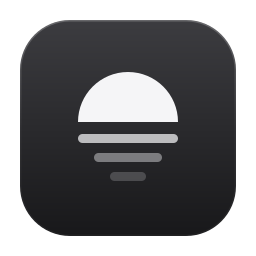
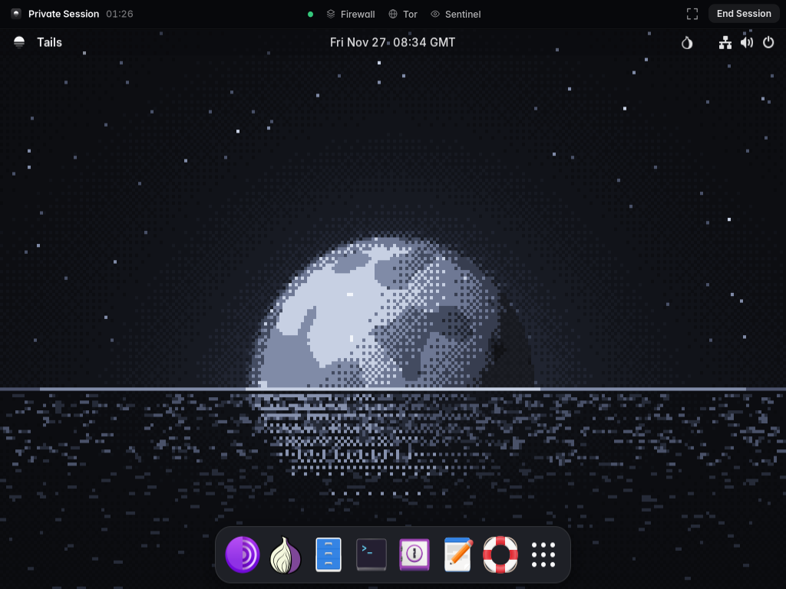
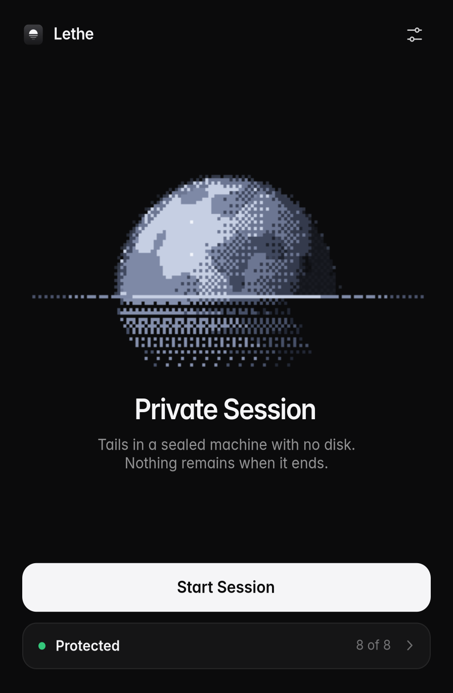

<div align="center">



# Lethe

**A private session that leaves no memory.**

Lethe runs [Tails](https://tails.net) in a sealed, amnesic virtual machine inside one window,<br>
connects it to Tor, and erases every trace of it when you are done.

Made for journalists, and for anyone whose sources depend on what a computer forgets.

<br>


<br>



</div>

## Quick start

```sh
gh repo clone cempack/lethe && ./lethe/install.sh
lethe
```

Press **Start Session**. About a minute later you are on a Tails desktop, connected to Tor.
Press **End Session** and its memory is overwritten with zeros.



| | |
|---|---|
| `lethe` | open the app |
| `lethe start` | open it and start a session at once |
| `lethe stop` | destroy the running session immediately |
| `lethe doctor` | check every protection on this machine |

Runs on Arch/Omarchy, Debian 12+, Ubuntu 24.04+, Fedora and openSUSE. Uninstall with `./install.sh --uninstall`.

## For journalists

- **Talk to a source, open a leak, research a story** in a workspace that exists only in memory. There is no virtual disk to seize or recover.
- **One click.** No USB stick, no reboot, no Welcome Screen, no Tor setup. Your own keyboard layout just works.
- **Bring things in, never out.** What you copy on your computer can be pasted in Tails (text and images). Nothing copied in Tails ever reaches your computer, and passwords from a password manager are never shared.
- **A tripwire while you work.** The session is destroyed at once if a debugger attaches, someone logs in remotely, or a new keyboard is plugged in. It hides itself while your screen is being recorded.

## What protects a session

| | |
|---|---|
| **Amnesia** | No disk. Guest memory is locked out of swap and crash dumps, zero-filled on exit, and wiped by a separate guard process even if Lethe is killed. The session dies before the computer sleeps. |
| **Integrity** | The Tails image is checked against the pinned Tails signing key before every start. Lethe's own files are root-owned and compared with a manifest. |
| **Sandbox** | QEMU/KVM inside bubblewrap: no home folder, no desktop socket, no D-Bus, no capabilities, no nested namespaces. |
| **Memory privacy** | Lethe, the VM and the wipe guard are closed to your other programs: no debugger, no reading their memory through `/proc`. |
| **Network** | The VM has no network of its own. A separate relay carries its traffic behind a kernel firewall: public internet only, never your LAN or this computer. |
| **VPN before Tor** | Optional WireGuard profile, for the VM only. The tunnel is its only route: if it drops, nothing leaves. |
| **Display** | The VM never touches your desktop. Its picture reaches Lethe over a private link; clipboard goes one way, on a read-only disc. |
| **Sentinel** | Watches the host during a session and destroys it at the first sign of tampering. |

Tails itself is hardened on the way in: Tor Browser at its Safest level, no usage history, no automounting, and a quiet Lethe desktop with GNOME's own dock.

<details>
<summary><b>What it cannot do</b></summary>

<br>

- **Protect you from a compromised computer.** If the host's kernel or firmware is controlled by someone else, they see everything. For that threat, boot Tails from a USB stick on a machine you trust.
- **Hide that you use it.** The Tails image and Lethe are on your disk. Session content is not.
- **Wipe everything.** Main guest memory is zero-filled; small device buffers are freed, not wiped. Booting the host with `init_on_free=1` closes that gap.
- **Hide Tor from your network**, unless you use the VPN option or Tor bridges.

</details>

<details>
<summary><b>How a session starts</b></summary>

<br>

1. The Tails image is verified, a sandbox is built, and Tails boots inside it.
2. Lethe passes the Welcome Screen, applies stricter settings and connects to Tor by pressing keys, like a person would: the image stays byte-for-byte the signed original.
3. Tails runs at your screen's real resolution and follows the window as you resize it. **Ctrl+Alt+F** is full screen; **Ctrl+Alt+V** types your clipboard where pasting cannot reach.
4. When the session ends, its memory is overwritten and the window tells you what was wiped.

</details>

The website lives in [`site/`](site): a static page with the same moon, live. Preview it with `python3 -m http.server -d site`, or build `site/Dockerfile`.

---

<div align="center">
<sub>Security audit and hardening pass by <b>Claude Mythos 5.2</b>. Inter typeface under the SIL Open Font License (<code>assets/Inter-LICENSE.txt</code>).</sub>
</div>
